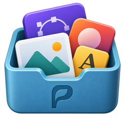

<div align="center">



# Pigoune

**P**latform for **I**cons and **G**raphics **O**rganized, **U**nified, **N**ative and **E**legant

*All your graphic assets, organized and within reach.*

[](COPYING)
[](https://www.gnome.org)
[](https://gtk-rs.org)
[](https://github.com/Gor3pig/Pigoune/releases/latest)

**English** · [Français](README.fr.md)

[Website](https://gor3pig.github.io/Pigoune/) · [User guide](help/en/README.md) · [Features](#features) · [Principles](#principles) · [Installation](#installation) · [Contributing](#contributing)


</div>

---

## What is Pigoune?

Icons in `Downloads`, logos in an old project folder, an SVG lost somewhere on the desktop…
**Pigoune gathers all of them in a single library**, neatly organized and pleasant to browse.
Your original files are never touched.

## Features

<table>
<tr>
<td width="33%" valign="top">

**Drop**<br>Files and folders, any common format, duplicates spotted.

</td>
<td width="33%" valign="top">

**Organize**<br>Collections, smart collections, nested tags, favorites.

</td>
<td width="33%" valign="top">

**Find**<br>Instant search and filters, even among thousands.

</td>
</tr>
<tr>
<td width="33%" valign="top">

**Reuse**<br>Drag, copy, export, or set as wallpaper.

</td>
<td width="33%" valign="top">

**Annotate**<br>Arrows, text and blur; the original is never touched.

</td>
<td width="33%" valign="top">

**Enjoy**<br>Zoomable preview, animations on hover, trash and undo.

</td>
</tr>
</table>

<p align="center"><b><a href="help/en/README.md">Read the user guide →</a></b><br>Everything Pigoune can do, step by step.</p>

## Principles

**Originals never modified** · **Fully local, no account** · **Portable libraries** · **Made for GNOME**

## Installation

### 1. Set up Flatpak

Fedora, Linux Mint, Pop!_OS and many other distributions ship Flatpak already. On Ubuntu and a
few others, follow the [official guide for your distribution](https://flathub.org/setup) first,
then restart your session.

### 2. Install Pigoune

Open [pigoune.flatpakref](https://gor3pig.github.io/Pigoune/pigoune.flatpakref) with the Software app, or
run this command:

```sh
flatpak install --user https://gor3pig.github.io/Pigoune/pigoune.flatpakref
```

### 3. Stay up to date

Pigoune is updated like your other apps: the Software app offers each new version, and every update is signed. The `.flatpak` file of
each version is also attached to its [release](https://github.com/Gor3pig/Pigoune/releases), and
you can build Pigoune yourself by following [CONTRIBUTING.md](CONTRIBUTING.md).

Pigoune runs on any Linux distribution that supports Flatpak, on a 64-bit Intel or AMD PC. There
is no version for Windows, macOS or ARM devices.

## User guide

The [user guide](help/en/README.md) walks you through everything Pigoune can do. In the app, it
also opens from the main menu or with <kbd>F1</kbd>.

## Contributing

Pigoune is free software and help is welcome: bug reports, ideas, translations and code.
[CONTRIBUTING.md](CONTRIBUTING.md) explains how to build Pigoune and submit a change,
[ARCHITECTURE.md](ARCHITECTURE.md) gives an overview of the code and
[po/README.md](po/README.md) explains how to translate it.

## License

Pigoune is free software released under the [GNU GPL v3 or later](COPYING).

The collection icons are from [Phosphor Icons](https://phosphoricons.com), released under the
[MIT license](crates/pigoune-app/icons/LICENSE-phosphor).
