# Guide d’utilisation de Pigoune

*[English version](../en/README.md)*

Pigoune range tous vos éléments graphiques (icônes, logos, illustrations) dans une seule bibliothèque bien organisée. Ce guide vous montre comment l’utiliser, de votre premier import aux réglages avancés.

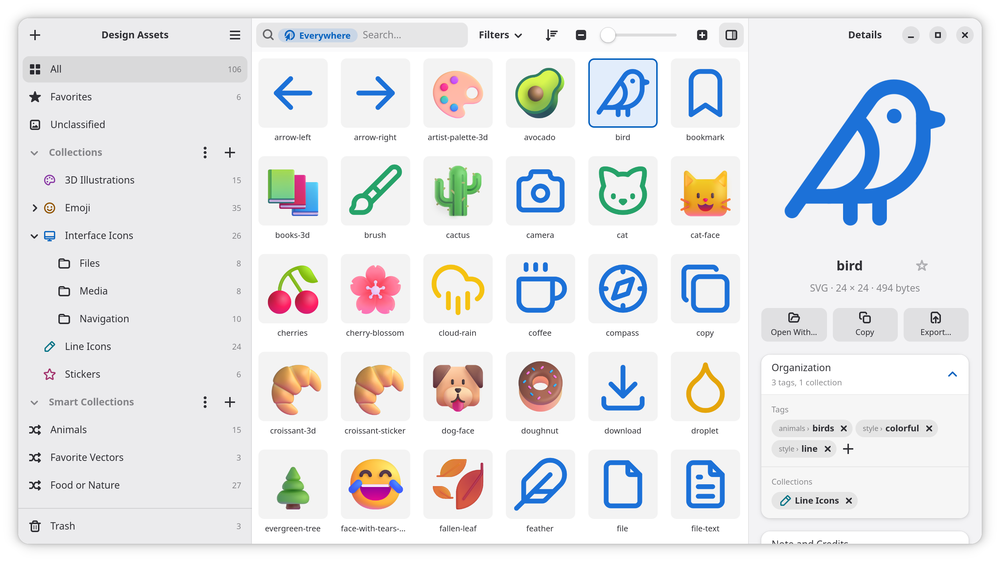

## Sommaire

**Découvrir**

- [Premiers pas](#premiers-pas) : créer une bibliothèque et y faire entrer des éléments
- [Organiser](#organiser) : collections, tags et favoris
- [Retrouver un élément](#retrouver-un-élément) : recherche, filtres et collections dynamiques
- [Regarder vos éléments](#regarder-vos-éléments) : la grille et l’aperçu détaillé

**Utiliser**

- [Réutiliser vos éléments](#réutiliser-vos-éléments) : glisser, exporter, convertir, fonds d’écran
- [Capturer et annoter](#capturer-et-annoter) : captures d’écran et annotations
- [Corbeille et annulation](#corbeille-et-annulation) : rattraper une erreur

**Aller plus loin**

- [Votre bibliothèque](#votre-bibliothèque) : stockage, santé, doublons, export
- [Préférences](#préférences) : les réglages
- [Raccourcis clavier](#raccourcis-clavier)
- [Questions et réponses](#questions-et-réponses)

## Premiers pas

> [!NOTE]
> Une **bibliothèque** est un dossier dans lequel Pigoune garde une copie de vos éléments. Créez-en une, puis importez-y vos fichiers.

### Créer une bibliothèque

Vous pouvez en créer autant que vous voulez, par exemple une par projet ou par client.

1. Sur l’écran d’accueil, choisissez **Nouvelle bibliothèque…**.
2. Donnez-lui un nom.
3. Choisissez où l’enregistrer.

Pour ouvrir une bibliothèque existante, choisissez **Ouvrir une bibliothèque…**.

### Passer d’une bibliothèque à l’autre

Pigoune rouvre la dernière bibliothèque utilisée à chaque démarrage.

Quand une bibliothèque est ouverte, le menu principal permet de :

- choisir **Nouvelle bibliothèque…** ou **Ouvrir une bibliothèque…** pour passer à une autre ;
- choisir **Fermer la bibliothèque** pour revenir à la page d’accueil, que Pigoune affiche aussi au prochain lancement.

#### Bibliothèques récentes

**Bibliothèques récentes**, dans le menu principal, liste les dernières bibliothèques ouvertes, cinq par défaut. La page d’accueil les affiche aussi, pour en rouvrir une d’un clic.

Pour nettoyer la liste, retirez une bibliothèque avec sa croix sur la page d’accueil, ou choisissez **Effacer la liste**, là ou dans le menu. Seule la liste change : les bibliothèques elles-mêmes sont conservées.

### Importer des éléments

Il y a quatre façons de faire entrer des éléments.

| Façon | Comment |
|---|---|
| **Menu d’importation** | Cliquez sur **+** en haut de la barre latérale, ou appuyez sur <kbd>Ctrl</kbd>+<kbd>I</kbd>, puis choisissez **Importer des fichiers…** ou **Importer un dossier…**. |
| **Glisser-déposer** | Glissez des fichiers ou des dossiers depuis Fichiers sur la fenêtre, ou sur **Tout**, **Non classés** ou une collection de la barre latérale. |
| **Copier-coller** | Copiez des fichiers dans Fichiers, ou une image (une capture d’écran, une image d’une page web), puis appuyez sur <kbd>Ctrl</kbd>+<kbd>V</kbd>. |
| **Depuis une page web** | Glissez une image d’une page web sur la fenêtre, ou sur une collection de la barre latérale. |

Une image collée s’appelle **Image collée** suivie de la date et de l’heure ; vous pouvez la renommer ensuite.

<details>
<summary>Ce que remet le navigateur</summary>

Pigoune garde ce que le navigateur lui remet : le fichier d’origine avec Chrome ou Brave, une copie PNG de l’image avec Firefox. Il nomme l’élément d’après le nom de fichier que le navigateur propose. Si le glissement ne contient aucune image, un message le dit.

</details>

#### Ce que Pigoune accepte

| Sujet | Règle |
|---|---|
| **Formats** | SVG, PNG, JPEG, WebP, AVIF, HEIC, JPEG XL, GIF, TIFF, BMP et ICO. |
| **Contrôles** | Chaque image est vérifiée avant d’être importée. Un fichier endommagé, ou qui ne peut pas être affiché, est signalé et refusé. |
| **Doublons** | Un fichier déjà présent n’est jamais copié deux fois. S’il est à la corbeille, l’importer le sort de la corbeille. |
| **Dossiers** | Quand vous importez un dossier, ses sous-dossiers deviennent des collections. |

Les photos HEIC s’affichent quand le système sait les décoder, ce que fait le paquet Flatpak.

Si vous importez dans une collection un fichier déjà présent, l’élément existant est ajouté à cette collection et reste dans les autres. S’il était à la corbeille, il est restauré et n’appartient alors qu’à cette collection.

> [!TIP]
> Vos fichiers d’origine ne sont jamais modifiés ni déplacés. Vous pouvez les supprimer une fois importés.

#### Où vont les fichiers

Les fichiers sont importés dans la vue que vous regardez.

| Vue | Ce qui se passe |
|---|---|
| **Tout** et **Non classés** | Les fichiers sont gardés sans collection. |
| Une collection sélectionnée | La collection les reçoit. |
| Favoris, tags, collections dynamiques, corbeille | Ils ne font que montrer des éléments : l’import y est désactivé. |

*Voir aussi : [Organiser](#organiser), [Votre bibliothèque](#votre-bibliothèque).* · [Retour au sommaire](#sommaire)

## Organiser

Les collections, les tags et les favoris gardent votre bibliothèque bien rangée. Utilisez ceux qui correspondent à votre façon de penser.

### Les collections

Les collections fonctionnent comme des dossiers et peuvent contenir d’autres collections.

#### Créer et gérer

Créez une collection avec le bouton **+** à côté de **Collections**, dans la barre latérale.

Faites ensuite un clic droit dessus pour y créer une sous-collection, la renommer (<kbd>F2</kbd>), la personnaliser, la déplacer avec **Déplacer vers…** (dans une autre collection ou au premier niveau) ou la supprimer. Le menu est présenté de la même façon pour les tags.

| Pour… | Faites ceci |
|---|---|
| **Personnaliser** | Clic droit, **Personnaliser…**, choisissez une couleur et une icône, puis **Enregistrer**. **Par défaut** remet le dossier gris. |
| **Réorganiser** | Glissez les collections dans la barre latérale, ou triez-les par nom ou par date de création avec le bouton **⋯** à côté de **Collections**. |
| **Replier** | Cliquez sur le titre d’une section de la barre latérale, ou appuyez sur <kbd>Entrée</kbd> quand il est sélectionné au clavier. Pigoune retient les sections repliées. |

**Non classés** regroupe les éléments qui n’appartiennent à aucune collection.

#### Mettre des éléments dans des collections

| Pour… | Faites ceci |
|---|---|
| **Déplacer** des éléments dans une collection | Glissez-les dessus depuis la grille, ou, dans une collection, utilisez **Déplacer vers une collection…** dans le menu du clic droit. |
| **Ajouter** des éléments sans les retirer de leur place | Maintenez <kbd>Ctrl</kbd> pendant le glisser, ou utilisez **Ajouter à une collection…** dans le menu du clic droit. |
| **Retirer** des éléments de la collection affichée | Utilisez **Retirer de la collection** dans le menu du clic droit. |

Un élément peut appartenir à plusieurs collections. Le retirer de l’une le garde dans la bibliothèque et dans ses autres collections.

Pendant le glisser, le curseur indique ce que vous faites : une flèche simple pour un déplacement, un **+** pour un ajout. Il change dès que vous appuyez sur <kbd>Ctrl</kbd> ou le relâchez.

> [!WARNING]
> Quand vous supprimez une collection, ses sous-collections le sont aussi, et les éléments qui n’appartenaient qu’à elles partent dans la corbeille. Ceux qui appartiennent aussi à une autre collection y restent.

### Les tags

Un tag est un mot-clé qui décrit un élément. Les tags peuvent être imbriqués, comme *Sujet › Animaux › chèvre*.

#### Écrire et ajouter des tags

Un tag est un seul mot de 20 caractères au plus. Pour réunir plusieurs mots, utilisez un tiret (*flat-design*).

Une espace ou une virgule termine le tag en cours de saisie, ce qui permet d’en saisir plusieurs à la fois.

| Pour ajouter des tags… | Faites ceci |
|---|---|
| **Depuis le panneau de détails** | Cliquez sur le bouton **+** à côté des tags. |
| **Depuis le menu** | Choisissez **Ajouter un tag…** dans le menu du clic droit. |
| **En glissant** | Glissez des éléments sur un tag de la barre latérale. |

Gardez les éléments glissés une seconde au-dessus d’un tag qui a des sous-tags : ils s’ouvrent, et vous pouvez déposer les éléments sur l’un d’eux. La barre latérale revient ensuite à sa place.

#### Parcourir les tags dans la barre latérale

La barre latérale montre les tags en pastilles avec leur nombre d’éléments.

- Cliquez sur une pastille pour voir tous ses éléments.
- Faites un clic droit dessus pour la renommer ou la supprimer.
- Au-delà de douze tags, **+ N autres** affiche la suite.

Renommer un tag avec le nom d’un autre les fusionne.

#### Les tags imbriqués

Tapez un chemin avec une barre oblique, par exemple `animaux/chèvre`, pour créer ou réutiliser chaque niveau. Chaque niveau est un seul mot de 20 caractères au plus.

| Sujet | Fonctionnement |
|---|---|
| **Suggestions** | Taper `animaux/` propose ses sous-tags, et chaque suggestion montre ses parents. |
| **Nom simple** | Un nom simple suivi de <kbd>Entrée</kbd> réutilise le tag de ce nom où qu’il soit. Si plusieurs tags le portent, choisissez le bon dans la liste. |
| **Même nom** | Le même nom peut exister dans deux branches différentes, mais pas deux fois au même niveau. |
| **Recherche** | Chercher le nom d’un parent trouve aussi les éléments de ses sous-tags. |

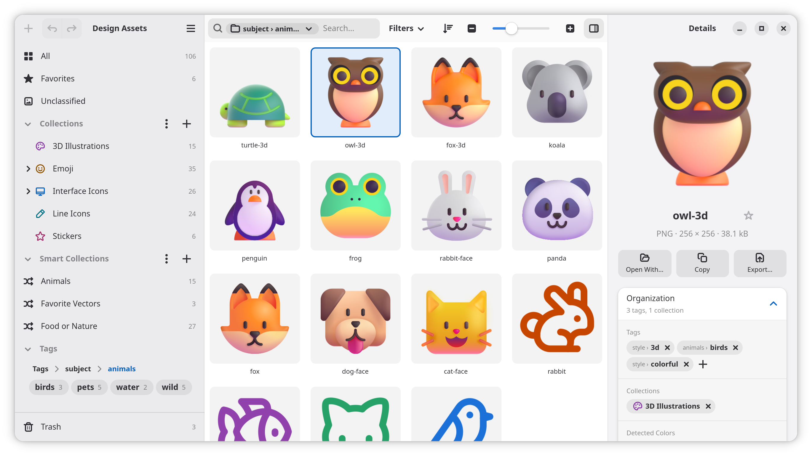

#### Se déplacer dans les tags imbriqués

La section Tags de la barre latérale montre toujours ce que montre la grille.

| Geste | Résultat |
|---|---|
| Cliquer sur le nom d’une pastille | La grille affiche ce tag avec les éléments de ses sous-tags, et ses sous-tags s’ouvrent dans la barre latérale. |
| Cliquer sur le chemin au-dessus des pastilles | Vous remontez. **Tags** revient au premier niveau et affiche de nouveau toute la bibliothèque. |
| Choisir autre chose dans la barre latérale | La section Tags revient au premier niveau. |

La pastille de recherche et les messages nomment un tag avec son chemin complet, par exemple *subject › animals*. Si certains des éléments que vous aviez sélectionnés ne sont pas dans la nouvelle vue, un court message dit combien.

#### Réorganiser les tags

Faites un clic droit sur un tag pour **Nouveau sous-tag…**, **Déplacer vers…**, **Fusionner dans…** et **Supprimer…**. Vous pouvez aussi glisser une pastille sur un autre tag, sur un niveau du chemin ou sur **Tags** pour la déplacer.

Chaque changement s’annule. Quand vous supprimez un tag qui a des sous-tags, vous choisissez de les supprimer aussi ou de les remonter d’un niveau.

<details>
<summary>Si vous supprimez le tag affiché</summary>

Pigoune affiche son parent, et l’annulation vous ramène sur le tag.

</details>

> [!NOTE]
> Vos tags actuels deviennent des tags de premier niveau, sans rien perdre.

### Les favoris

Les favoris ont leur propre entrée dans la barre latérale. Pour y ajouter un élément :

- cliquez sur l’étoile à côté de son nom, dans le panneau de détails ;
- appuyez sur <kbd>Ctrl</kbd>+<kbd>D</kbd> ;
- ou glissez des éléments sur **Favoris** dans la barre latérale.

### Noms, notes et crédits

Dans le panneau de détails :

| Quoi | Comment |
|---|---|
| **Renommer** | Cliquez sur le nom de l’élément, ou appuyez sur <kbd>F2</kbd>. |
| **Note et crédits** | Écrivez une note et indiquez la source, la licence et l’auteur, ce qui est bien pratique au moment de réutiliser l’élément. |
| **Fichier** | Indique quand l’élément a été ajouté et le nom du fichier d’origine. |
| **Actions rapides** | Sous le nom, **Ouvrir avec…**, **Copier** et **Exporter…** agissent directement sur l’élément. |

Chaque groupe se replie et se déplie d’un clic sur son titre, qui affiche aussi un court résumé. Pigoune retient ceux qui sont ouverts.

### Plusieurs éléments à la fois

Sélectionnez plusieurs éléments avec <kbd>Ctrl</kbd>+clic, <kbd>Maj</kbd>+clic, un rectangle tracé depuis un espace vide de la grille, ou <kbd>Ctrl</kbd>+<kbd>A</kbd>.

Le panneau de détails affiche alors un résumé et permet de changer les favoris et les tags de tous. Le glisser et le menu du clic droit agissent sur toute la sélection.

> [!TIP]
> Un tag porté par une partie seulement des éléments sélectionnés est entouré de pointillés, avec son nombre (par exemple 2/5). Cliquez sur son nom pour l’ouvrir, ou sur le petit **+** à côté pour l’ajouter à tous.

*Voir aussi : [Retrouver un élément](#retrouver-un-élément), [Corbeille et annulation](#corbeille-et-annulation).* · [Retour au sommaire](#sommaire)

## Retrouver un élément

Cherchez par mots, affinez la grille avec des filtres, et enregistrez une recherche qui se tient à jour toute seule.

### La recherche

Cliquez dans le champ de recherche, appuyez sur <kbd>Ctrl</kbd>+<kbd>F</kbd>, ou commencez simplement à taper.

Pigoune cherche dans les noms, les tags, les notes, les sources, les licences et les auteurs. Il ignore les majuscules, les accents et les ligatures (*coeur* trouve *cœur*), et un mot peut n’être qu’un morceau de mot : `chat` trouve aussi *château*.

La recherche ne regarde pas le format. Pour ne garder que les SVG, par exemple, utilisez le bouton **Filtres**.

#### Où il cherche

Une petite pastille au début du champ de recherche indique où Pigoune cherche : **Partout**, ou le nom de l’entrée sélectionnée dans la barre latérale. Cliquez dessus pour choisir **Dans toute la bibliothèque** ou **Dans** l’entrée.

- Quand vous choisissez une entrée de la barre latérale alors qu’une recherche regarde partout, la grille montre cette entrée avec votre recherche appliquée dedans. Taper de nouveau élargit la recherche comme avant.
- Dans **Tout**, la corbeille et les collections dynamiques, la pastille reste sans menu, car la recherche y regarde toujours au même endroit.

Dans une fenêtre étroite, le champ laisse la place à une loupe en haut à droite. Cliquez dessus, appuyez sur <kbd>Ctrl</kbd>+<kbd>F</kbd> ou commencez à taper : une barre de recherche pleine largeur s’ouvre sous la barre de titre, avec la même pastille et le bouton **Filtres**. <kbd>Échap</kbd> la ferme et efface la recherche.

#### Plusieurs mots

| Vous tapez | Pigoune trouve |
|---|---|
| `logo chèvre` | Les éléments qui contiennent *logo* **et** *chèvre*, même à des endroits différents |
| `logo, chèvre` | Les éléments qui contiennent *logo* **ou** *chèvre* |
| `logo rouge, chèvre` | Ce qui contient à la fois *logo* et *rouge*, ou bien *chèvre* |

Une **espace** veut dire *et*, une **virgule** veut dire *ou*. Les virgules découpent la recherche en groupes : un élément est trouvé dès qu’il contient tous les mots d’un groupe. Par exemple, *logo* peut être dans le nom et *chèvre* dans un tag.

#### Les pastilles de mots

À partir de deux mots, les mots apparaissent en pastilles sous le champ de recherche, reliées par **et** ou **ou**.

- Cliquez sur un **ou** pour réunir les deux groupes voisins.
- Cliquez sur un **et** pour couper le groupe en deux à cet endroit.
- Cliquez sur la croix d’une pastille pour retirer son mot.

Dans `logo rouge, chèvre`, cliquer sur le **ou** donne `logo rouge chèvre` (les trois mots sont exigés). Cliquer sur le **et** donne `logo, rouge, chèvre` (un seul suffit).

Les mêmes pastilles apparaissent sous **Mots à rechercher** dans la fenêtre des collections dynamiques. Une recherche utilise 8 mots au maximum : les suivants sont ignorés, et les pastilles l’indiquent.

### Les filtres

Le bouton **Filtres** affine la grille par type, favoris, couleur et orientation. Les filtres s’ajoutent à votre recherche et les uns aux autres.

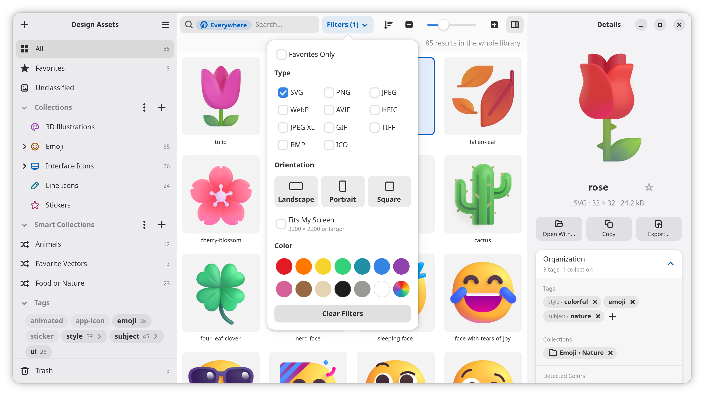

#### Types et favoris

Cochez un ou plusieurs formats pour ne garder que ceux-là, par exemple SVG. **Favoris seulement** garde vos favoris.

#### Couleurs

Pigoune note les couleurs principales de chaque élément, jusqu’à trois qui couvrent chacune au moins 15 % de l’image visible, sans compter les zones transparentes. **Filtres** propose treize couleurs : choisissez rouge et bleu pour voir les éléments surtout rouges ou bleus.

La dernière pastille, arc-en-ciel, ouvre le sélecteur de couleur de GNOME pour choisir n’importe quelle couleur, par exemple la couleur exacte d’une charte graphique. Pigoune garde alors les éléments dont une couleur principale en est proche. Un nouveau clic sur la pastille la retire.

Les couleurs s’ajoutent aux types et aux favoris : rouge et SVG montrent les SVG rouges.

> [!NOTE]
> À la première ouverture d’une ancienne bibliothèque, ses éléments sont analysés en arrière-plan pendant que vous continuez à travailler. Un élément pas encore analysé ne correspond à aucune couleur.

#### Orientation et taille d’écran

**Orientation** garde les éléments au format **Paysage**, **Portrait** ou **Carré**. Choisissez-en deux pour voir les deux. Une image compte comme carrée quand ses côtés diffèrent de 5 % au plus.

**Adapté à mon écran** garde les images au moins aussi grandes que l’écran où se trouve Pigoune, en vrais pixels et dans les deux sens, par exemple 1920 × 1080 ou plus. Elles remplissent l’écran sans être agrandies, donc sans flou. Les SVG sont toujours mis de côté.

> [!TIP]
> **Paysage** et **Adapté à mon écran** ensemble trouvent de bons fonds d’écran.

### Savoir où est rangé un élément

Regardez **Collections** dans le groupe **Organisation** du panneau de détails. Un clic sur une collection l’ouvre dans la barre latérale et met l’élément en évidence. Un clic sur un tag fonctionne de la même façon.

**Couleurs détectées** montre les couleurs principales trouvées par Pigoune. Pour ne garder que les éléments d’une couleur, utilisez le bouton **Filtres**.

### Les collections dynamiques

Une collection dynamique est une recherche enregistrée qui se tient à jour toute seule : elle affiche toujours les éléments qui correspondent à ses critères, y compris ceux que vous importez plus tard. Par exemple, *tous mes SVG favoris* ou *toutes les images en paysage adaptées à mon écran*.

Elle cherche toujours dans toute la bibliothèque, sauf la corbeille. On ne peut pas déposer d’éléments sur une collection dynamique, puisque son contenu suit ses critères.

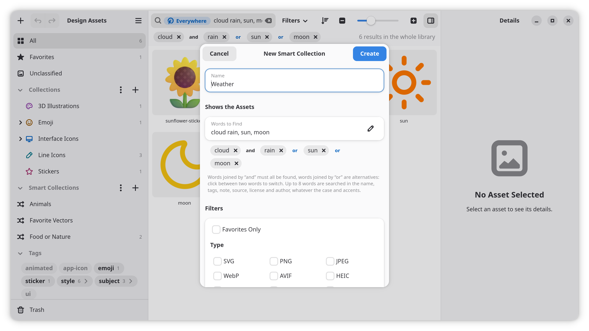

#### Créer une collection dynamique

1. Cliquez sur le bouton **+** à côté de **Collections dynamiques** dans la barre latérale. La fenêtre est préremplie avec la recherche et les filtres en cours, et avec **Favoris seulement** quand **Favoris** est ouvert.
2. Donnez-lui un nom.
3. Choisissez au moins un critère : des mots à rechercher, des types, des orientations, des couleurs, **Adapté à mon écran** ou **Favoris seulement**.

**Mots à rechercher** fonctionne exactement comme le champ de recherche : espaces et virgules, et pastilles dont les **et** et les **ou** coupent ou réunissent les groupes. **Adapté à mon écran** suit l’écran où se trouve Pigoune au moment où vous ouvrez la collection dynamique.

#### Utiliser et gérer

| Pour… | Faites ceci |
|---|---|
| **L’ouvrir** | Cliquez dessus dans la barre latérale. Vous pouvez encore chercher à l’intérieur. |
| **La modifier** | **Modifier…** dans son menu du clic droit, ou <kbd>F2</kbd>. |
| **La supprimer** | **Supprimer…**. Seule la recherche enregistrée disparaît : les éléments restent dans la bibliothèque. |
| **Les réorganiser** | Glissez-les dans la barre latérale, ou triez-les par nom ou par date de création avec le bouton **⋯** à côté de leur titre. |

*Voir aussi : [Organiser](#organiser), [Regarder vos éléments](#regarder-vos-éléments).* · [Retour au sommaire](#sommaire)

## Regarder vos éléments

Parcourez la grille, puis ouvrez l’aperçu détaillé pour examiner un élément de près.

### La grille

- **Taille** : changez la taille des vignettes avec le curseur au-dessus de la grille, ou avec <kbd>Ctrl</kbd>+<kbd>+</kbd> et <kbd>Ctrl</kbd>+<kbd>-</kbd>. Le curseur fixe la taille minimale : les vignettes grandissent légèrement pour que chaque rangée occupe toute la largeur de la fenêtre.
- **Tri** : le bouton de tri ordonne la grille par date d’ajout, nom, type, dimensions ou poids.
- **Animations** : les GIF, PNG et WebP animés s’animent au survol, sauf si votre système est réglé pour réduire les animations.

### L’aperçu détaillé

Appuyez sur <kbd>Espace</kbd> ou double-cliquez sur un élément pour ouvrir l’aperçu détaillé. Appuyez sur <kbd>Espace</kbd> ou <kbd>Échap</kbd> pour revenir.

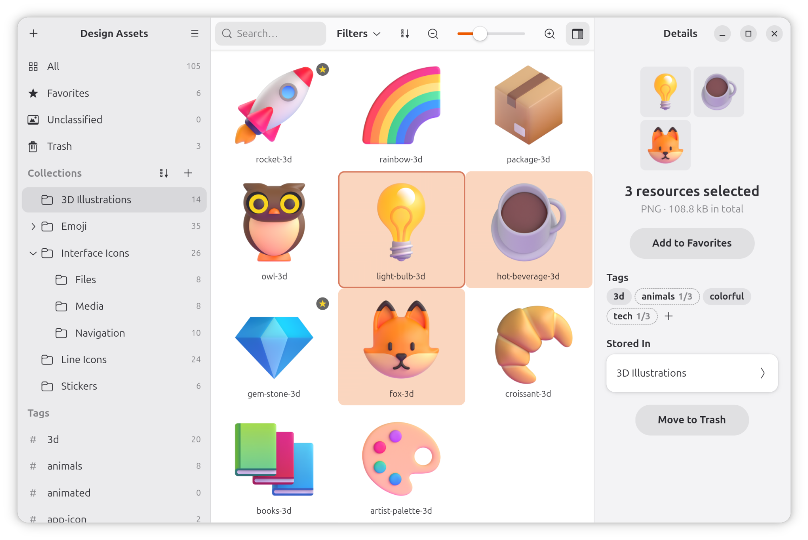

#### Zoomer et déplacer

| Pour… | Faites ceci |
|---|---|
| **Zoomer** | Utilisez la molette, ou <kbd>+</kbd> et <kbd>-</kbd>. |
| **Ajuster à la fenêtre** | Appuyez sur <kbd>0</kbd>. |
| **Voir la taille réelle** | Appuyez sur <kbd>1</kbd>. |
| **Déplacer une image zoomée** | Faites-la glisser, ou utilisez <kbd>Maj</kbd> et les flèches. |
| **Changer le fond** | Utilisez le bouton **Fond** de la barre du haut. |

Vous pouvez faire glisser l’image pour en examiner n’importe quelle partie, même un coin amené au milieu de l’écran.

#### Passer d’un élément à l’autre

- Utilisez les flèches du clavier, les boutons fléchés qui apparaissent quand vous bougez la souris, ou un balayage à deux doigts. <kbd>Début</kbd> et <kbd>Fin</kbd> mènent au premier et au dernier élément.
- Une bande de vignettes en bas montre les éléments voisins : cliquez sur l’une d’elles pour l’afficher. Elle est masquée en plein écran et dans les fenêtres étroites. Désactivez-la avec **Afficher la bande de vignettes** dans le menu du zoom.
- Appuyez sur <kbd>F11</kbd>, ou choisissez **Plein écran** dans le menu du zoom, pour occuper tout l’écran. La barre du haut revient quand vous bougez la souris ou appuyez sur <kbd>Tab</kbd>, et <kbd>Échap</kbd> quitte le plein écran.

#### Agir sur l’élément

- Les boutons **Ouvrir avec…**, **Copier** et **Exporter vers…** de la barre du haut agissent sur l’élément affiché.
- **Afficher les détails** ouvre le panneau de détails à côté de l’élément, pour le taguer, le ranger ou lui ajouter une note sans quitter l’aperçu. Pigoune retient s’il est ouvert.
- L’étoile à côté du bouton de retour ajoute l’élément à vos favoris.
- <kbd>Suppr</kbd> envoie l’élément à la corbeille, et l’aperçu passe au suivant.

Un clic droit sur l’image propose **Ouvrir avec…**, **Afficher dans Fichiers**, **Copier**, **Exporter vers…**, **Convertir et exporter…**, **Cadrer et définir comme fond d’écran…**, **Ajouter aux favoris** et **Mettre à la corbeille**.

#### Vérifier icônes et pixels

- Un contour en pointillés montre les vrais bords de l’image, marges transparentes comprises. Désactivez-le avec **Afficher les limites de l’image** dans le menu du zoom.
- À partir de 800 %, une grille légère sépare les pixels des images, pratique pour vérifier une icône ou du pixel art. Désactivez-la avec **Afficher la grille des pixels** dans le menu du zoom.
- Pour un fichier ICO qui contient plusieurs tailles, des boutons sous l’image affichent chaque taille telle qu’elle a été dessinée (16, 32, 48, 256…).

#### Animations

Pour une animation, une barre sous l’image la met en pause, la relance et la parcourt image par image, en indiquant l’image affichée.

Au clavier, <kbd>K</kbd> met en pause ou relance, et <kbd>,</kbd> et <kbd>.</kbd> affichent l’image précédente et suivante.

*Voir aussi : [Réutiliser vos éléments](#réutiliser-vos-éléments), [Raccourcis clavier](#raccourcis-clavier).* · [Retour au sommaire](#sommaire)

## Réutiliser vos éléments

Sortez vos éléments de Pigoune, ou transformez-les : une copie, un export, un fond d’écran.

### En un coup d’œil

| Je veux… | Comment | Détails |
|---|---|---|
| Utiliser un élément dans une autre application | Le glisser depuis la grille | [Glisser et copier](#glisser-et-copier) |
| Copier un élément | <kbd>Ctrl</kbd>+<kbd>C</kbd>, puis coller | [Glisser et copier](#glisser-et-copier) |
| Enregistrer des éléments dans un dossier | **Exporter vers…** | [Exporter vers un dossier](#exporter-vers-un-dossier) |
| Enregistrer toute la bibliothèque en dossiers | **Gérer la bibliothèque**, onglet **Export** | [Exporter vers un dossier](#exporter-vers-un-dossier) |
| Changer le format ou la taille | **Convertir et exporter…** | [Convertir et exporter](#convertir-et-exporter) |
| Modifier un élément dans une autre application | **Ouvrir avec…** | [Ouvrir et localiser](#ouvrir-et-localiser) |
| Voir le fichier sur le disque | **Afficher dans Fichiers** | [Ouvrir et localiser](#ouvrir-et-localiser) |
| Trouver ce qui se ressemble | **Trouver des éléments similaires…** | [Trouver des éléments similaires](#trouver-des-éléments-similaires) |
| Faire un fond d’écran | **Cadrer et définir comme fond d’écran…** | [Fonds d’écran](#fonds-décran) |

Hormis le glisser-déposer, la copie et l’export de toute la bibliothèque, ces actions sont dans le menu du clic droit d’un élément.

### Glisser et copier

Glissez des éléments depuis la grille vers n’importe quelle application : un éditeur de texte, un logiciel de graphisme, une page web… Pigoune y dépose une copie qui porte le nom de l’élément.

Pour les copier à la place, appuyez sur <kbd>Ctrl</kbd>+<kbd>C</kbd> et collez-les ailleurs.

<details>
<summary>Si un curseur de déplacement apparaît</summary>

Certaines applications, comme Fichiers, peuvent afficher un curseur de déplacement. C’est la copie remise qui se déplace, jamais l’élément de votre bibliothèque.

</details>

### Exporter vers un dossier

Choisissez **Exporter vers…** dans le menu du clic droit, puis un dossier. Les fichiers existants ne sont jamais écrasés.

Pour exporter toute la bibliothèque en dossiers ordinaires, utilisez l’onglet **Export** de **Gérer la bibliothèque** (voir [Exporter toute la bibliothèque](#exporter-toute-la-bibliothèque)).

### Convertir et exporter

Changez le format et la taille pendant l’export. Choisissez **Convertir et exporter…** dans le menu du clic droit, puis :

1. Choisissez PNG, JPEG, WebP, AVIF ou ICO.
2. Réglez les options ci-dessous.
3. Choisissez un dossier.

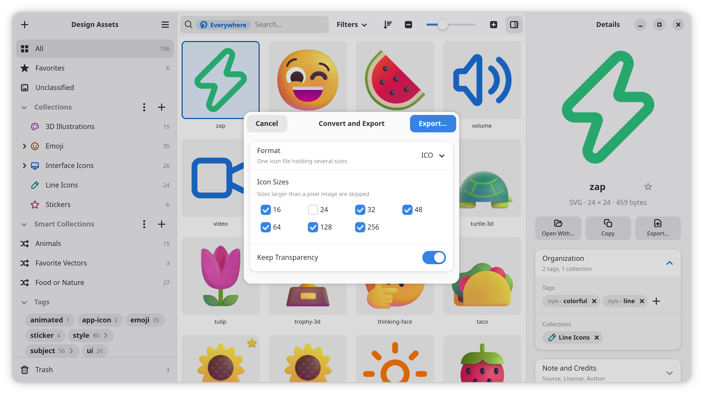

#### Options de format

| Option | Effet |
|---|---|
| **Qualité** | JPEG et AVIF proposent un réglage de qualité. |
| **Fond** | Une couleur de fond remplit les zones transparentes. Le JPEG en utilise toujours une, car il n’a pas de transparence. |
| **Tailles de l’icône** | Cochez les tailles à inclure (16, 32, 48 et 256 par défaut). Elles vont toutes dans un seul fichier d’icône. |

Les autres formats gardent la transparence, sauf si vous désactivez **Garder la transparence** pour utiliser aussi une couleur de fond.

#### Options de taille

| Option | Effet |
|---|---|
| **Largeur et hauteur** | En pixels ou en pourcentage. 100 % garde la taille d’origine. |
| **Garder les proportions** (le cadenas) | Fermé, les proportions sont gardées : changer un côté ajuste l’autre. Ouvrez-le pour étirer librement une image. |
| **Taille de mon écran** | Adapte plusieurs images à votre écran d’un coup : chaque image prend exactement la taille de l’écran où se trouve Pigoune, par exemple 1920 × 1080. |
| **Remplir l’écran** | Couvre tout l’écran et coupe les bords qui dépassent, autour du centre. |
| **Image entière** | Garde toute l’image et remplit les bandes avec la couleur de fond, ou les laisse transparentes quand la transparence est gardée. |

Cadenas fermé, plusieurs images de formes différentes tiennent chacune dans la largeur et la hauteur indiquées.

<details>
<summary>À savoir</summary>

- Un SVG reste net à toutes les tailles ; une image en pixels agrandie devient floue.
- Un fichier redimensionné porte sa taille dans son nom, par exemple `logo-512x384.png`.
- Depuis l’aperçu, une animation en pause sur une image exporte cette image, nommée par exemple `spinner-image-3.png`.
- Pigoune retient votre format, votre qualité, votre fond et votre unité pour le prochain export, et la taille repart toujours de l’original.
- L’original reste intact dans la bibliothèque, et les fichiers existants ne sont jamais écrasés.

</details>

### Ouvrir et localiser

| Pour… | Faites ceci |
|---|---|
| **Ouvrir** un élément dans une autre application, un logiciel de retouche par exemple | Choisissez **Ouvrir avec…**. L’application reçoit une copie. |
| **Retrouver le fichier sur le disque** | Choisissez **Afficher dans Fichiers**. Votre gestionnaire de fichiers s’ouvre sur le fichier stocké dans la bibliothèque. |

Votre bibliothèque reste intacte : enregistrez vos modifications sous un nouveau nom et importez-les si vous voulez les garder.

> [!WARNING]
> Le fichier montré par **Afficher dans Fichiers** est le vrai fichier. Ne le déplacez pas, ne le renommez pas et ne le modifiez pas depuis là : la vérification de l’onglet **Santé** le signalerait.

### Trouver des éléments similaires

Choisissez **Trouver des éléments similaires…** dans le menu du clic droit d’un seul élément. Une fenêtre liste ceux qui lui ressemblent, du plus proche au plus éloigné, même dans un autre format ou une autre taille.

Chacun est marqué **Presque identique**, **Très proche** ou **Ressemblant**. Dans chaque mention, ceux dont les couleurs sont les plus proches passent en premier. En choisir un l’affiche dans Tout.

> [!NOTE]
> Si l’élément n’a pas encore été analysé, ou si son dessin est trop simple pour être comparé (une seule couleur, ou rien de visible), la fenêtre le dit.

### Fonds d’écran

Cadrez n’importe quelle image et faites-en votre fond d’écran. Choisissez **Cadrer et définir comme fond d’écran…** dans le menu du clic droit de la grille ou de l’aperçu.

#### Cadrer l’image

Une grande fenêtre montre un écran virtuel à la résolution réelle de l’écran où se trouve Pigoune, par exemple 1920 × 1080, avec l’image cadrée comme GNOME le ferait.

| Pour… | Faites ceci |
|---|---|
| **Déplacer** l’image | Faites-la glisser. |
| **Zoomer** | Utilisez la molette, le curseur, ou <kbd>+</kbd> et <kbd>-</kbd>. |
| **Ajuster** | Utilisez les flèches (<kbd>Maj</kbd> pour aller plus loin). |

Trois boutons règlent le cadrage :

| Bouton | Effet |
|---|---|
| **Remplir** | Revient au cadrage de GNOME. |
| **Entière** | Montre toute l’image. |
| **100 %** | Montre un pixel de l’image par pixel de l’écran. |

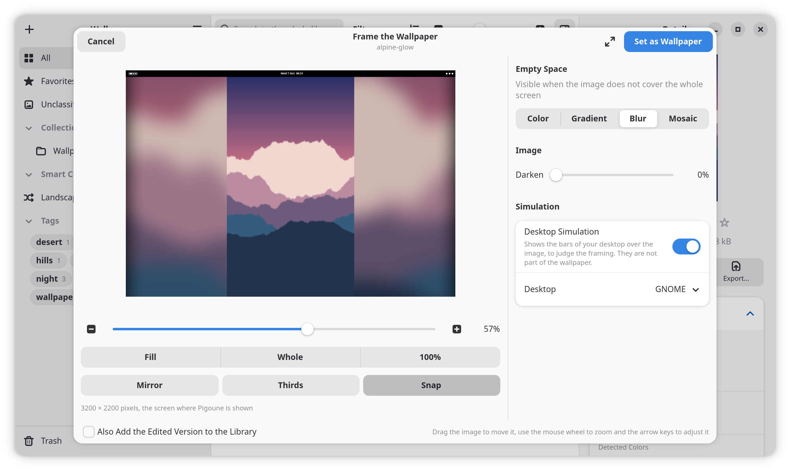

#### Aides au cadrage

| Option | Effet |
|---|---|
| **Miroir** | Retourne l’image de gauche à droite, dans le fond d’écran seulement. |
| **Règle des tiers** | Affiche la grille des tiers, pour placer le sujet. |
| **Magnétisme** | Actif au départ : l’image glissée s’accroche au centre et aux bords de l’écran, une ligne bleue montrant où. |

Ce qui dépasse de l’écran reste visible, en pâle. Quand l’image est agrandie au-delà de 100 %, une pastille sur l’écran prévient qu’elle sera floue.

Le bouton plein écran, ou <kbd>F11</kbd>, montre l’écran virtuel en vraie grandeur, comme une simulation que rappelle une courte pastille. <kbd>Échap</kbd> pour revenir.

#### Image et écrans

| Option | Effet |
|---|---|
| **Assombrir** (sous **Image**) | Assombrit tout le fond d’écran, jusqu’à 60 %, pour que les icônes et les barres restent lisibles. |
| **Préparer pour** | Avec plusieurs écrans, choisit celui pour lequel le fond d’écran est fabriqué. GNOME affiche le même fond d’écran sur tous les écrans et l’adapte aux autres. |
| **Simulation du bureau** | Dessine une imitation des barres de votre bureau sur l’écran virtuel. Désactivez-la pour voir l’image seule. |

Comme **Miroir**, **Assombrir** ne change que le fond d’écran, jamais l’élément.

Elle imite GNOME, KDE Plasma, Cinnamon, Xfce, MATE, COSMIC ou Budgie, celui que vous utilisez étant choisi d’office.

#### Espace vide

Sous **Espace vide**, choisissez ce qui remplit l’écran autour d’une image plus petite.

| Choix | Ce qu’il fait |
|---|---|
| **Couleur** | Noire au départ. Choisissez parmi les couleurs principales de l’image, le noir et le blanc. |
| **Dégradé** | Part des deux couleurs principales de l’image, du haut vers le bas. |
| **Flou** | La même image, agrandie et floutée derrière elle. |
| **Mosaïque** | L’image répétée sur tout l’écran, pratique pour les motifs. |

La pastille arc-en-ciel ouvre le sélecteur de couleur de GNOME.

Un dégradé a trois réglages de plus :

| Réglage | Effet |
|---|---|
| **Angle** | Fait tourner le dégradé (0° vers le haut, 90° vers la droite, 180° vers le bas). |
| **Couleur de début** et **Couleur de fin** | Ouvrent le sélecteur de couleur de GNOME. |
| **Inverser les couleurs** | Échange les deux couleurs. |

#### Définir le fond d’écran

**Définir comme fond d’écran** fabrique une image exactement à la taille de l’écran : le bureau montre exactement ce que vous avez cadré. Une petite fenêtre montre la préparation, puis GNOME vous demande de confirmer.

Cochez **Ajouter aussi à la bibliothèque la version modifiée** pour garder cette image comme nouvel élément.

*Voir aussi : [Capturer et annoter](#capturer-et-annoter), [Votre bibliothèque](#votre-bibliothèque).* · [Retour au sommaire](#sommaire)

## Capturer et annoter

Faites une capture d’écran, collez une image ou ouvrez-en une de votre bibliothèque, puis annotez-la avec des formes, du texte, des flèches, du flou et plus encore.

L’éditeur s’ouvre dans la fenêtre d’une bibliothèque ouverte : il y a donc toujours un endroit où garder le résultat.

> [!NOTE]
> Les annotations ne modifient jamais le fichier d’origine. Elles sont conservées à côté, et vous pouvez les modifier plus tard.

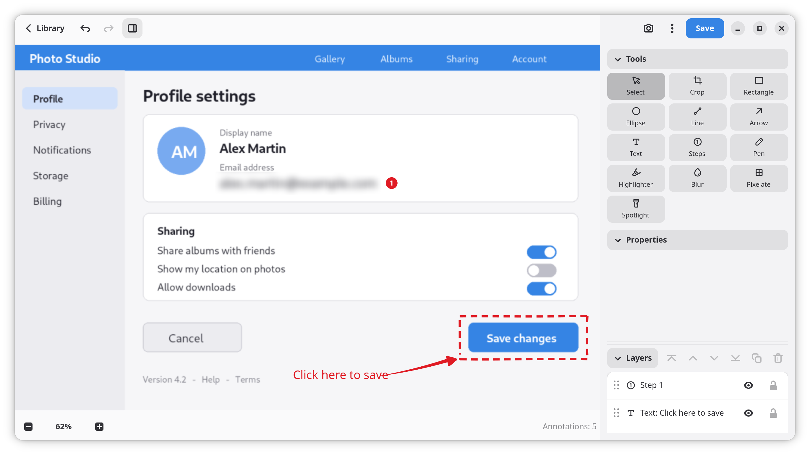

### Commencer une capture

#### Faire une capture d’écran

Choisissez **Faire une capture d’écran** dans le menu d’importation, appuyez sur <kbd>Ctrl</kbd>+<kbd>Maj</kbd>+<kbd>S</kbd>, ou utilisez l’action **Faire une capture d’écran** de l’icône de Pigoune (clic droit dessus dans votre lanceur).

Pigoune cache sa fenêtre, et votre bureau vous demande de choisir la zone, une fenêtre ou tout l’écran.

#### Coller une image

Copiez une image n’importe où, puis choisissez **Coller et annoter** dans le menu d’importation ou appuyez sur <kbd>Ctrl</kbd>+<kbd>Maj</kbd>+<kbd>V</kbd>.

#### Annoter une image de votre bibliothèque

Sélectionnez l’image et choisissez **Annoter…** dans le panneau de détails ou le menu contextuel, ou appuyez sur <kbd>Ctrl</kbd>+<kbd>E</kbd>.

#### Partir d’un raccourci de votre bureau

Associez la commande `pigoune --capture` (ou la commande Flatpak complète ci-dessous) à une touche dans les réglages de votre bureau :

```sh
flatpak run io.github.gor3pig.Pigoune --capture
```

Si Pigoune n’est pas lancé, il démarre, rouvre votre dernière bibliothèque et fait la capture.

Les images peuvent faire jusqu’à 8000 pixels de côté.

### Annoter

Les outils sont dans le panneau de l’éditeur, à droite (dans une fenêtre étroite, dans le panneau qui monte du bas). Chaque outil a une lettre qui le sélectionne, indiquée dans son infobulle.

| Outil | Touche | Ce qu’il fait |
|---|---|---|
| Sélection | <kbd>V</kbd> | Sélectionner, déplacer et redimensionner une annotation |
| Rogner | <kbd>C</kbd> | Ne garder qu’une partie de l’image |
| Rectangle, Ellipse | <kbd>R</kbd>, <kbd>O</kbd> | Contours, remplis ou à coins arrondis |
| Ligne, Flèche | <kbd>L</kbd>, <kbd>A</kbd> | Droites ou courbes, avec plusieurs pointes |
| Texte | <kbd>T</kbd> | Cliquez, tapez, puis cliquez ailleurs ou appuyez sur <kbd>Ctrl</kbd>+<kbd>Entrée</kbd> |
| Étapes | <kbd>N</kbd> | Pastilles numérotées (ou lettrées) qui se renumérotent seules |
| Crayon, Surligneur | <kbd>P</kbd>, <kbd>H</kbd> | Traits à main levée, lissés |
| Flou, Pixelisation | <kbd>B</kbd>, <kbd>X</kbd> | Cacher une information privée : l’effet s’applique à tout ce qui est dessiné en dessous |
| Projecteur | <kbd>S</kbd> | Assombrit tout sauf un rectangle ou un ovale |

<kbd>Suppr</kbd> supprime l’annotation sélectionnée. **Rogner** fonctionne avec des proportions libres ou fixes.

#### Les réglages d’un outil

Chaque outil retient ses derniers réglages jusqu’à la fermeture de Pigoune : couleur (avec une pipette pour en prélever une dans l’image), opacité, épaisseur, ombre et plus. L’outil Texte a aussi la police, la taille, le gras, l’italique, le fond, la bulle et le contour.

- **Type de trait** choisit un trait continu, en tirets ou pointillé, pour les rectangles, ellipses, lignes, flèches et le crayon.
- **Aspect du tracé** (Précis, Esquissé ou Très esquissé) donne aux rectangles, ellipses, lignes et flèches l’allure légèrement tremblée d’un dessin fait à la main.
- Une forme garde le même aspect à chaque ouverture, et une copie est exactement semblable à l’original.
- Les flèches peuvent être régulières ou effilées.

#### Dessiner avec précision

- Maintenez <kbd>Maj</kbd> en dessinant pour des lignes droites à des multiples de 45 degrés, et de parfaits carrés ou cercles.
- Maintenez <kbd>Alt</kbd> en déplaçant pour couper les guides qui alignent une annotation sur l’image et sur les autres annotations.
- Annuler et rétablir fonctionnent comme partout : <kbd>Ctrl</kbd>+<kbd>Z</kbd> et <kbd>Ctrl</kbd>+<kbd>Maj</kbd>+<kbd>Z</kbd>.

#### Sélectionner et modifier

Une nouvelle annotation reste sélectionnée : vous pouvez la déplacer, la redimensionner par ses poignées et changer ses réglages tout de suite, sans quitter l’outil en cours.

- Avec un outil de dessin, appuyez sur le contour d’une annotation pour la saisir, ou n’importe où ailleurs, même à l’intérieur d’une autre annotation, pour dessiner. L’outil **Sélection** saisit aussi une annotation par son intérieur.
- Une flèche sélectionnée a une poignée ronde au milieu : tirez-la pour courber la flèche, double-cliquez dessus pour la redresser.
- Un flou, une pixelisation ou un projecteur sélectionné a une poignée ronde au centre : tirez-la pour déplacer la zone avec n’importe quel outil.
- Les flèches du clavier déplacent la sélection d’un pixel (dix avec <kbd>Maj</kbd>).
- <kbd>Ctrl</kbd>+<kbd>Maj</kbd>+<kbd>D</kbd> la duplique.

### Calques

Chaque annotation est un calque. Le panneau **Calques** les liste de l’avant vers l’arrière.

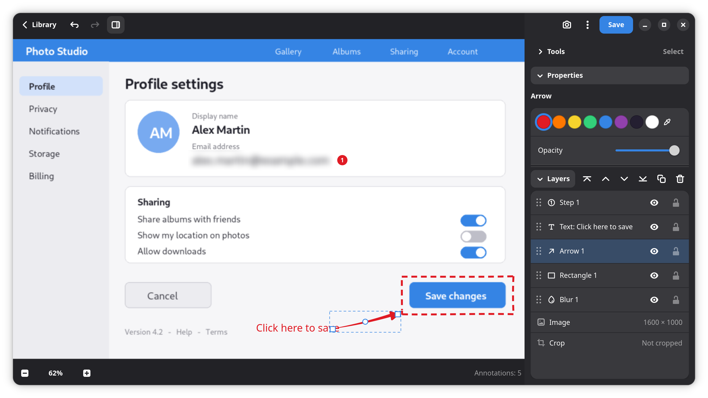

| Pour… | Faites ceci |
|---|---|
| **Changer l’ordre** | Utilisez les boutons au-dessus de la liste, ou glissez une ligne. |
| **Masquer ou afficher** | Cliquez sur l’œil d’une ligne. |
| **Verrouiller** | Cliquez sur le cadenas, pour que l’annotation ne soit pas déplacée par erreur. |
| **Renommer, dupliquer, supprimer** | Faites un clic droit sur une ligne. |

<kbd>Ctrl</kbd>+<kbd>]</kbd> et <kbd>Ctrl</kbd>+<kbd>[</kbd> changent aussi l’ordre, avec <kbd>Maj</kbd> pour les extrêmes.

Un calque masqué disparaît de l’éditeur et du résultat, mais n’est pas supprimé : vous pouvez le réafficher à tout moment.

### Votre espace de travail

**Outils**, **Propriétés** et **Calques** se replient et se déplient d’un clic sur leur titre.

Le bouton à côté de **Rétablir** dans l’en-tête, ou <kbd>F9</kbd>, masque tout le panneau de l’éditeur pour laisser plus de place à l’image. **Enregistrer** et les boutons de copie, d’export et de capture passent alors dans l’en-tête.

Pigoune retient les sections repliées et l’état du panneau. Rien de cela ne change vos annotations, l’outil choisi ou le zoom.

### Cacher ce qui est privé

Une annotation **Flou** ou **Pixelisation** cache ce qui est dessous, annotations comprises. Comme toute annotation, elle ne détruit rien : le fichier d’origine reste exactement tel qu’il a été importé, et le flou ou la pixelisation reste modifiable. Elle s’enregistre avec les autres annotations, et vous pouvez la déplacer, la redimensionner, la masquer ou la changer plus tard.

> [!WARNING]
> L’image d’origine reste dans votre bibliothèque, avec ce que vous aviez caché. Une pixelisation à gros blocs supprime les détails qu’elle recouvre, mais un flou léger n’est pas une anonymisation et peut rester en partie récupérable. Pour tout ce qui est sensible, préférez une pixelisation ou un flou fort, et ne partagez pas le fichier d’origine.

Pigoune en tient compte :

- Si un flou ou une pixelisation est masqué (avec l’œil de son calque), certaines informations peuvent redevenir visibles dans le résultat. Pigoune vous avertit avant de **copier**, d’**exporter** ou d’**ouvrir avec une autre application** une image qui en a un, et propose de l’afficher d’abord quand vous êtes dans l’éditeur.
- Glisser une telle image hors de Pigoune est refusé tant que vous n’avez pas réaffiché les effets masqués, sans possibilité de continuer malgré tout.
- L’export de toute la bibliothèque donne chaque original **et** une copie de chaque image annotée : les originaux peuvent donc contenir des choses qui ne sont plus visibles sur les copies annotées. Pigoune vous demande si vous voulez aussi les originaux avant d’exporter.

### Garder le résultat

- **Enregistrer** ajoute l’image annotée à votre bibliothèque sous un nom fait de la date, avec le tag `capture`, et l’affiche sélectionnée. Une image déjà présente dans la bibliothèque est refusée, et le message nomme l’élément existant.
- Le menu à côté d’**Enregistrer** copie l’image annotée dans le presse-papiers ou l’exporte en PNG.
- Si Pigoune se ferme pendant que vous modifiez, la capture est gardée en brouillon, et Pigoune propose de la reprendre la prochaine fois qu’une bibliothèque s’ouvre.

#### Rouvrir les annotations plus tard

Sélectionnez un élément annoté et choisissez **Annoter…** (dans le panneau de détails ou le menu contextuel). L’enregistrement met à jour le même élément. **Voir l’original** ouvre une copie de l’image intacte dans une autre application.

La grille, l’aperçu et les doublons utilisent l’image annotée. La copier ou l’exporter donne un PNG aplati. L’original reste à côté, va à la corbeille et en revient avec elle, et compte dans l’espace utilisé par votre bibliothèque.

### Comparer avec l’original

Dans l’aperçu détaillé, une image annotée affiche un bouton en forme d’œil en bas à droite. **Maintenez**-le enfoncé pour voir l’image d’origine, puis relâchez : l’image annotée revient aussitôt.

C’est une vue momentanée, pas une bascule, pour que rien ne reste affiché par erreur : l’image annotée revient aussi si vous changez d’image, fermez l’aperçu ou quittez la fenêtre.

Rien n’est modifié ni enregistré. Le bouton est grisé si le fichier d’origine n’est pas disponible.

*Voir aussi : [Réutiliser vos éléments](#réutiliser-vos-éléments), [Raccourcis clavier](#raccourcis-clavier).* · [Retour au sommaire](#sommaire)

## Corbeille et annulation

Rien n’est perdu tant que vous ne videz pas la corbeille, et la plupart des modifications peuvent être annulées.

### La corbeille

Appuyez sur <kbd>Suppr</kbd>, ou choisissez **Mettre à la corbeille** dans le menu du clic droit, pour envoyer des éléments à la corbeille.

Ouvrez **Corbeille**, en bas de la barre latérale, pour restaurer des éléments, avec **Restaurer** dans le menu du clic droit ou dans le panneau de détails, ou pour la vider définitivement.

Les éléments de la corbeille peuvent encore être copiés, exportés ou ouverts avec une autre application, mais pas modifiés.

### Annuler et rétablir

| Pour… | Faites ceci |
|---|---|
| **Annuler** | Appuyez sur <kbd>Ctrl</kbd>+<kbd>Z</kbd>, cliquez sur **Annuler** en haut de la barre latérale, ou sur **Annuler** dans le message qui apparaît après une action. |
| **Rétablir** | Appuyez sur <kbd>Ctrl</kbd>+<kbd>Maj</kbd>+<kbd>Z</kbd> (ou <kbd>Ctrl</kbd>+<kbd>Y</kbd>), ou cliquez sur **Rétablir** à côté de **Annuler** ou dans le message qui suit une annulation. |

Vous pouvez rétablir un changement annulé tant que vous n’en faites pas un autre.

#### Ce qui peut être annulé

- La mise à la corbeille, le déplacement, les tags, les favoris, le renommage, les notes et crédits.
- La création, le renommage, la personnalisation, le déplacement ou la suppression d’une collection.
- La création, la modification, la réorganisation ou la suppression d’une collection dynamique.

#### Bon à savoir

- Les imports ne s’annulent pas, et vider la corbeille efface l’historique des annulations.
- Si un import sort un élément de la corbeille, sa mise à la corbeille précédente ne figure plus dans l’historique des annulations.
- La création d’une collection ne s’annule que tant qu’elle est vide. Une fois des éléments importés dedans, utilisez plutôt **Supprimer…**.
- Quand une annulation n’est plus possible, Pigoune le dit et laisse ce changement tel quel. Le <kbd>Ctrl</kbd>+<kbd>Z</kbd> suivant annule le changement d’avant.
- Un message qui suit une action ne compte que ce qui a vraiment changé : les éléments déjà dans la collection ou déjà étiquetés ne sont pas comptés.

*Voir aussi : [Organiser](#organiser), [Votre bibliothèque](#votre-bibliothèque).* · [Retour au sommaire](#sommaire)

## Votre bibliothèque

Une bibliothèque est un simple dossier dont le nom se termine par `.pigoune`. Tout ce que Pigoune garde pour vous s’y trouve.

### Ce qu’elle contient

- `files/` : une copie de chaque élément, avec son nom de fichier d’origine, rangée dans de petits sous-dossiers pour que même une très grande bibliothèque reste facile à manipuler.
- `library.db` : la base de données qui contient les collections, les tags et toutes les autres informations.
- `cache/` : les vignettes et les données d’analyse des images, que Pigoune peut refaire à tout moment.

### La déplacer et la sauvegarder

Comme tout se trouve dans ce dossier, une bibliothèque est **portable** : copiez-la sur un disque externe ou sur un autre ordinateur et ouvrez-la là-bas avec Pigoune. Pour la sauvegarder, copiez le dossier entier pendant que Pigoune est fermé.

Une bibliothèque ne peut être ouverte que dans une seule fenêtre de Pigoune à la fois. Si vous la gardez dans un dossier synchronisé (Nextcloud, Syncthing…), fermez Pigoune sur un ordinateur avant de l’ouvrir sur un autre.

> [!NOTE]
> Une bibliothèque ouverte et mise à niveau avec Pigoune 3.0 ne peut plus être ouverte avec Pigoune 2.12 ou plus ancien. **Gérer la bibliothèque** indique quelles versions peuvent l’ouvrir.

### Gérer la bibliothèque

Choisissez **Gérer la bibliothèque** dans le menu principal pour voir ce que contient la bibliothèque ouverte et vous en occuper. Elle compte six onglets.

| Onglet | À quoi il sert |
|---|---|
| **Vue d’ensemble** | Voir les chiffres et les records de la bibliothèque |
| **Contenu** | Voir la répartition des formats et des couleurs |
| **Stockage** | Voir la place que la bibliothèque prend sur votre disque |
| **Santé** | Comparer les fichiers à la base de données |
| **Doublons** | Trouver les éléments qui se ressemblent |
| **Export** | Copier tous les éléments dans des dossiers |

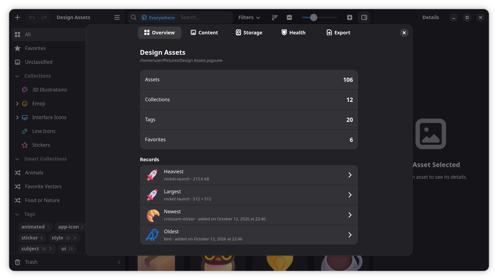

#### Vue d’ensemble

Le nom et l’emplacement de la bibliothèque, le nombre d’éléments, de collections, de tags et de favoris, et le **Palmarès** : l’élément le plus lourd, le plus grand, le plus récent et le plus ancien. Cliquez sur l’un d’eux pour le voir dans la grille.

#### Contenu

Un graphique en anneau montre comment la place se répartit entre les formats, en poids ou en nombre d’éléments. L’onglet montre aussi le nombre d’images animées, de SVG et d’éléments dans la corbeille, et les couleurs détectées avec le nombre d’éléments dont chacune est une couleur principale.

#### Stockage

Une seule barre montre la place de la bibliothèque sur son disque, répartie entre les éléments, les vignettes, la base de données et la corbeille, à côté des autres fichiers et de l’espace libre.

En dessous, vous trouvez l’emplacement de la bibliothèque, avec des boutons pour le copier ou ouvrir son dossier, et si ce disque est amovible. Vous y trouvez aussi la place prise par les vignettes, sa date de création et les versions de Pigoune capables de l’ouvrir.

**Vider**, à côté des vignettes, libère leur place. Elles sont recréées quand on en a besoin.

### Vérifier la santé de la bibliothèque

L’onglet **Santé** compare les fichiers du disque avec la base de données de la bibliothèque.

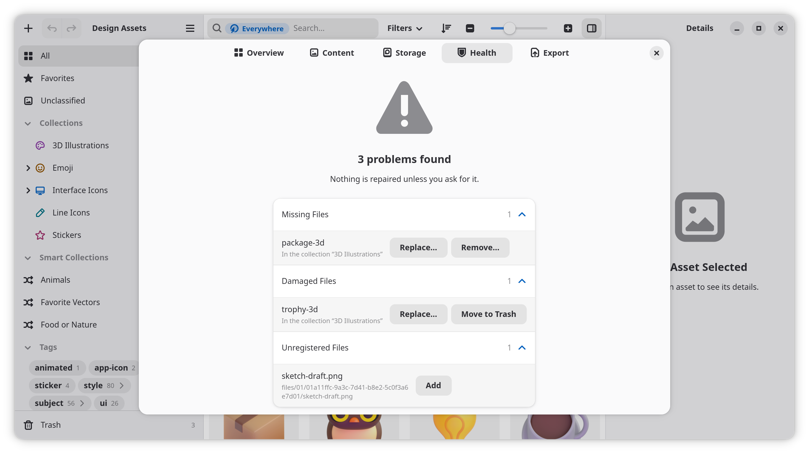

**Vérifier** lit chaque fichier, sauf ceux de la corbeille, et liste :

- les fichiers **manquants** ;
- les fichiers **endommagés**, dont le contenu ne correspond plus à ce qui a été importé ;
- les fichiers **non référencés**, qui sont dans le dossier de la bibliothèque mais que la base de données ne connaît pas.

La vérification se fait en arrière-plan et peut être annulée. Elle ne modifie ni ne supprime jamais rien d’elle-même. Les éléments qui sont dans la corbeille ne sont pas signalés : leurs fichiers partent avec la corbeille, et si vous en restaurez un, la vérification suivante le regarde de nouveau.

#### Corriger un problème

- **Ajouter** (ou **Tout ajouter**) remet un fichier non référencé dans la bibliothèque, dans Non classés, sans déplacer le fichier. Pigoune explique pourquoi quand un fichier ne peut pas être ajouté, par exemple s’il n’est pas une image.
- **Remplacer…** permet de choisir une copie du fichier d’origine d’un fichier manquant ou endommagé. Pigoune ne l’accepte que si son contenu est identique à ce qui a été importé, puis la remet en place en conservant le nom, les tags et les collections de l’élément.
- **Retirer de la bibliothèque** enlève un élément manquant dont il ne reste aucune copie, après une confirmation qui précise que c’est définitif. Un fichier endommagé, qui existe encore, ne le propose jamais.
- **Mettre à la corbeille** est proposé à la place pour un fichier endommagé. Vous pouvez l’annuler depuis le message qui apparaît.

### Trouver les doublons

L’onglet **Doublons** regroupe les éléments qui se ressemblent, comme le même logo en PNG et en SVG, ou en deux tailles.

Pigoune analyse discrètement l’image de chaque élément en arrière-plan, seulement quand vous ne l’utilisez pas. L’onglet Vue d’ensemble montre où il en est, et l’onglet Doublons indique combien d’éléments attendent encore.

#### Lancer la recherche

Cliquez sur **Rechercher**. Pigoune regarde d’abord de près, une seule fois, les éléments qui pourraient être des doublons, puis les compare, avec une barre de progression et un bouton **Annuler**. Il liste les groupes, la plus grande image en premier.

- Un groupe montre ses six premiers éléments. **Afficher les N autres** en ajoute vingt à la fois, et les vignettes se chargent au fil du défilement.
- Chaque groupe n’est qu’une suggestion : les éléments se ressemblent, ce qui ne les rend pas identiques.
- Pigoune compare les dessins en deux temps, puis marque chaque élément **Identique** ou **Probable** par rapport au plus grand. Un groupe ne réunit que des éléments qui s’accordent tous entre eux, 40 au plus à la fois.

#### Nettoyer un groupe

1. Choisissez l’élément à garder avec son bouton rond. La plus grande image est choisie d’abord, et la choisir ne supprime rien.
2. Cochez la case (« Mettre à la corbeille ») de chaque élément à retirer. Rien n’est coché à votre place.
3. Cliquez sur **Mettre N éléments à la corbeille…**, qui apparaît dès qu’une case est cochée. Un récapitulatif montre ce qui est gardé et ce qui part à la corbeille, avec les collections, tags et notes qui restent derrière.
4. Confirmez. Seuls les éléments cochés sont déplacés, et **Annuler** ne change rien.

Si les éléments ont changé depuis la recherche, Pigoune ne déplace rien et relance la recherche. Le message qui apparaît permet d’annuler : les éléments restent dans la corbeille jusqu’à ce que vous la vidiez. Choisir une ligne affiche cet élément dans Tout.

#### Ignorer ce qui n’est pas un doublon

- **Ignorer le groupe** dans le menu « ⋯ » d’un groupe, ou **Pas un doublon** dans le menu « ⋯ » d’une ligne, empêche Pigoune de proposer ces éléments comme doublons les uns des autres. Le message permet d’annuler.
- **Ignorés (N)**, en haut de l’onglet, liste ce que vous avez ignoré. Chaque entrée est soit un groupe, soit un seul élément avec ceux dont il est écarté.
- **Ne plus ignorer** défait exactement une entrée, et **Tout réafficher…** toutes.

Le bouton **Ignorés** reste là quand vous rouvrez **Gérer la bibliothèque**, et **Annuler** (<kbd>Ctrl</kbd>+<kbd>Z</kbd>) met la liste à jour.

<details>
<summary>Ce que change « Ignorer »</summary>

Ignorer un groupe ne concerne que les éléments de ce groupe. Ils ne sont plus proposés ensemble, ni avec les autres éléments qui leur ressemblent, et ces autres éléments restent proposés dans leurs propres groupes. Une nouvelle image qui ressemble à l’un d’eux reste proposée avec celui-ci.

</details>

### Exporter toute la bibliothèque

L’onglet **Export** copie tous les éléments dans un dossier de votre choix.

- Pigoune crée un dossier au nom de la bibliothèque, avec un sous-dossier par collection et sous-collection, et y place les fichiers d’origine. L’onglet montre un exemple tiré de votre propre bibliothèque.
- Les éléments qui n’appartiennent à aucune collection vont dans un dossier **Non classés**. Un élément qui appartient à plusieurs collections est copié dans chacune. Les éléments à la corbeille sont laissés de côté.
- Une image annotée est exportée avec son original **et** une copie de l’image annotée. Voir [Cacher ce qui est privé](#cacher-ce-qui-est-privé).
- Rien n’est jamais écrasé : si un dossier du même nom existe déjà, l’export est créé sous le nom `Nom (2)`. Le bouton est grisé quand la bibliothèque est vide.

> [!NOTE]
> Les tags, notes et favoris restent dans Pigoune : ce n’est donc pas une sauvegarde complète. Pour cela, copiez le dossier de la bibliothèque.

*Voir aussi : [Préférences](#préférences), [Réutiliser vos éléments](#réutiliser-vos-éléments).* · [Retour au sommaire](#sommaire)

## Préférences

Ouvrez les **Préférences** depuis le menu principal, ou appuyez sur <kbd>Ctrl</kbd>+<kbd>,</kbd>. Les réglages sont répartis sur quatre pages. La loupe en haut retrouve un réglage par son nom.

### Général

| Réglage | Ce qu’il fait |
|---|---|
| **Langue de l’interface** | Suit votre système, ou choisissez une autre langue. Elle s’applique au prochain démarrage ; **Redémarrer** le fait tout de suite. |
| **Rouvrir la dernière bibliothèque** | Au lancement, ouvre la bibliothèque laissée ouverte. Désactivez-le pour partir de la page d’accueil. |
| **Bibliothèques récentes** | Combien de bibliothèques récentes le menu principal et la page d’accueil proposent, de 0 à 8. |
| **Rouvrir la dernière entrée** | Une bibliothèque s’ouvre sur l’entrée utilisée la dernière fois plutôt que sur **Tout**. |
| **Afficher les nouveautés après une mise à jour** | Une courte fenêtre présente les principales nouveautés au premier démarrage d’une nouvelle version. |
| **Confirmer avant de vider la corbeille** | Demande confirmation avant que la corbeille soit vidée. |
| **Vider automatiquement la corbeille** | Les éléments sont supprimés définitivement après 30 jours dans la corbeille. Désactivé au départ. |

Quelques fenêtres fournies par GNOME, comme celle qui permet de choisir un dossier, peuvent rester dans la langue du système. Choisissez 0 bibliothèque récente pour désactiver la liste. La fenêtre À propos garde les nouveautés de la version en cours.

### Affichage

#### Options de la grille

| Réglage | Ce qu’il fait |
|---|---|
| **Afficher le nom des éléments** | Affiche le nom sous chaque vignette. Quand les noms sont masqués, survolez une vignette pour voir son nom. |
| **Noms des éléments cliquables** | Affiché seulement quand les noms sont affichés. Désactivez-le et le nom compte comme de l’espace vide. |
| **Afficher les formats** | Une pastille indique le format de chaque élément (SVG, PNG…) sur sa vignette. |
| **Fond des vignettes** | Blanc, gris, noir ou damier, pour voir les images blanches ou noires et les zones transparentes. |
| **Animer les vignettes au survol** | Désactivez-le si les vignettes qui bougent vous distraient. Les animations se jouent toujours dans le panneau de détails et l’aperçu. |

Quand les noms ne sont pas cliquables, seule la vignette réagit aux clics, aux doubles clics et aux glissers, et un rectangle de sélection peut partir du nom.

#### Options de la barre latérale

| Réglage | Ce qu’il fait |
|---|---|
| **Afficher le nombre d’éléments** | Affiche un nombre à côté de chaque entrée. Pendant une recherche ou un filtre, seuls les éléments qui correspondent sont comptés. |
| **Afficher les tags** | Désactivez-le pour masquer la section des tags. Les tags restent visibles dans le panneau de détails, et la recherche les trouve toujours. |
| **Afficher les collections dynamiques** | Désactivez-le pour masquer cette section. Vos collections dynamiques sont conservées et reviennent quand vous le réactivez. |

Les tags qui n’ont aucun élément correspondant sont estompés pendant une recherche ou un filtre.

### Comportement

| Réglage | Ce qu’il fait |
|---|---|
| **Ouvrir les éléments au double-clic** | Un double-clic ouvre l’élément dans son application par défaut au lieu de l’aperçu. <kbd>Espace</kbd> ouvre toujours l’aperçu. |
| **Rechercher dans toute la bibliothèque** | La recherche et les filtres regardent partout, pas seulement dans l’entrée sélectionnée, sauf dans la corbeille et dans les collections dynamiques. |

**Rechercher dans toute la bibliothèque** est activé au premier démarrage, et la pastille du champ de recherche le change à tout moment.

### Raccourcis

La plupart des raccourcis listés dans [Raccourcis clavier](#raccourcis-clavier) peuvent être modifiés ici. Sélectionnez une action, puis appuyez sur la nouvelle combinaison de touches.

- Pigoune refuse une combinaison déjà utilisée par une autre action, en vous disant laquelle.
- Il refuse aussi une lettre seule (taper dans la grille lance une recherche, utilisez donc <kbd>Ctrl</kbd> ou <kbd>Alt</kbd> avec une touche, ou une touche de fonction), et les touches qu’il garde pour lui, comme <kbd>F2</kbd>, <kbd>F10</kbd> et <kbd>F11</kbd>.
- Un bouton à côté d’un raccourci modifié rétablit sa valeur par défaut, et **Rétablir tous les raccourcis** les rétablit tous.
- Les raccourcis standards (copier, coller, tout sélectionner, annuler, rétablir et quitter) sont affichés avec un cadenas et ne peuvent pas être modifiés.
- Quelques actions, comme importer un dossier, exporter ou restaurer des éléments, n’ont aucun raccourci tant que vous ne leur en donnez pas un.

### Style et couleurs

Le style et la couleur d’accentuation ne se règlent pas dans les Préférences : Pigoune suit ceux que vous choisissez dans les **Paramètres** de GNOME, rubrique **Apparence**. Ils couvrent le style clair ou sombre, et la couleur des sélections, des interrupteurs et des surlignages.

*Voir aussi : [Raccourcis clavier](#raccourcis-clavier), [Votre bibliothèque](#votre-bibliothèque).* · [Retour au sommaire](#sommaire)

## Raccourcis clavier

Appuyez sur <kbd>Ctrl</kbd>+<kbd>?</kbd> pour voir tous les raccourcis de Pigoune. La plupart peuvent être modifiés dans les **Préférences**, sur la page **Raccourcis**.

### Bibliothèques et import

| Action | Raccourci |
|---|---|
| Nouvelle bibliothèque | <kbd>Ctrl</kbd>+<kbd>N</kbd> |
| Ouvrir une bibliothèque | <kbd>Ctrl</kbd>+<kbd>O</kbd> |
| Importer des fichiers | <kbd>Ctrl</kbd>+<kbd>I</kbd> |
| Coller des fichiers ou une image pour les importer | <kbd>Ctrl</kbd>+<kbd>V</kbd> |

### Parcourir

| Action | Raccourci |
|---|---|
| Rechercher | <kbd>Ctrl</kbd>+<kbd>F</kbd> |
| Aperçu détaillé | <kbd>Espace</kbd> ou <kbd>Entrée</kbd> |
| Tout sélectionner / tout désélectionner | <kbd>Ctrl</kbd>+<kbd>A</kbd> / <kbd>Échap</kbd> |
| Copier | <kbd>Ctrl</kbd>+<kbd>C</kbd> |
| Vignettes plus grandes / plus petites | <kbd>Ctrl</kbd>+<kbd>+</kbd> / <kbd>Ctrl</kbd>+<kbd>-</kbd> |
| Menu contextuel | <kbd>Menu</kbd> ou <kbd>Maj</kbd>+<kbd>F10</kbd> |

### Ranger vos éléments

| Action | Raccourci |
|---|---|
| Renommer l’élément sélectionné | <kbd>F2</kbd> |
| Ajouter aux favoris ou en retirer | <kbd>Ctrl</kbd>+<kbd>D</kbd> |
| Ajouter un tag | <kbd>Ctrl</kbd>+<kbd>T</kbd> |
| Ajouter à une collection | <kbd>Ctrl</kbd>+<kbd>K</kbd> |
| Déplacer vers une autre collection (depuis une collection) | <kbd>Ctrl</kbd>+<kbd>M</kbd> |
| Mettre à la corbeille | <kbd>Suppr</kbd> |

### Barre latérale

| Action | Raccourci |
|---|---|
| Renommer ou modifier l’entrée sélectionnée | <kbd>F2</kbd> |
| Supprimer la collection, la collection dynamique ou le tag sélectionné | <kbd>Suppr</kbd> |
| Passer d’une entrée à l’autre | <kbd>Haut</kbd> / <kbd>Bas</kbd> |
| Déplier ou replier une entrée | <kbd>Droite</kbd> / <kbd>Gauche</kbd> |

### Annotation

| Action | Raccourci |
|---|---|
| Faire une capture d’écran à annoter | <kbd>Ctrl</kbd>+<kbd>Maj</kbd>+<kbd>S</kbd> |
| Coller une image à annoter | <kbd>Ctrl</kbd>+<kbd>Maj</kbd>+<kbd>V</kbd> |
| Annoter l’image sélectionnée | <kbd>Ctrl</kbd>+<kbd>E</kbd> |
| Afficher ou masquer le panneau de l’éditeur | <kbd>F9</kbd> |

Les lettres des outils sont listées dans [Annoter](#annoter).

### Partout

| Action | Raccourci |
|---|---|
| Annuler | <kbd>Ctrl</kbd>+<kbd>Z</kbd> |
| Rétablir | <kbd>Ctrl</kbd>+<kbd>Maj</kbd>+<kbd>Z</kbd> ou <kbd>Ctrl</kbd>+<kbd>Y</kbd> |
| Aide | <kbd>F1</kbd> |
| Préférences | <kbd>Ctrl</kbd>+<kbd>,</kbd> |
| Fermer la fenêtre | <kbd>Ctrl</kbd>+<kbd>W</kbd> |
| Quitter | <kbd>Ctrl</kbd>+<kbd>Q</kbd> |

*Voir aussi : [Préférences](#préférences).* · [Retour au sommaire](#sommaire)

## Questions et réponses

### Puis-je supprimer mes fichiers d’origine après les avoir importés ?

Oui. Pigoune travaille sur ses propres copies, rangées dans la bibliothèque.

### Annoter une image modifie-t-il mon original ?

Non. Les annotations, flou et pixelisation compris, sont conservées à côté de l’original, qui reste exactement tel qu’il a été importé. Lisez [Cacher ce qui est privé](#cacher-ce-qui-est-privé) avant de partager une image annotée.

### Pigoune envoie-t-il quelque chose sur internet ?

Non. Pigoune fonctionne entièrement hors ligne, sans compte et sans télémétrie. La recherche de mises à jour est faite par Flatpak, qui demande seulement au dépôt de Pigoune si une nouvelle version existe.

### Comment mettre Pigoune à jour ?

Logiciels s’en charge : il propose chaque nouvelle version, et l’installe tout seul si les mises à jour automatiques sont activées. `flatpak update` l’installe aussi.

Si Pigoune reste ouvert, une bannière en haut de la fenêtre l’annonce aussi dans la demi-heure. Cliquez sur **Mettre à jour**, attendez la fin de l’installation, puis cliquez sur **Redémarrer**.

### Pourquoi Pigoune dit-il qu’un fichier est illisible ?

Le fichier est endommagé, ou n’est pas vraiment dans le format qu’indique son nom. Pigoune vérifie le contenu de chaque image, pas seulement son extension.

### J’ai importé deux fois le même fichier. Où est la deuxième copie ?

Il n’y en a pas. Pigoune reconnaît les doublons et ajoute plutôt l’élément existant à la collection visée.

### Comment signaler un bug ou proposer une idée ?

Ouvrez un ticket (*issue*) sur [GitHub](https://github.com/Gor3pig/Pigoune/issues).

*Voir aussi : [Premiers pas](#premiers-pas).* · [Retour au sommaire](#sommaire)
